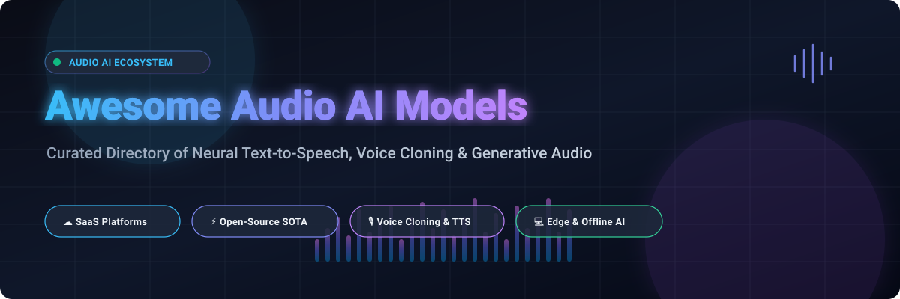

<p align="center">
  
</p>

# 🎙️ Awesome Audio AI Models

<p align="center">
  <a href="https://github.com/ishandutta2007/Awesome-Audio-AI-Models/stargazers"></a>
  <a href="https://github.com/ishandutta2007/Awesome-Audio-AI-Models/network/members"></a>
  <a href="https://github.com/ishandutta2007/Awesome-Audio-AI-Models/blob/main/LICENSE"></a>
  <a href="https://github.com/sindresorhus/awesome"></a>
  <a href="https://github.com/ishandutta2007/Awesome-Audio-AI-Models/pulls"></a>
</p>

> **A curated, comprehensive directory of state-of-the-art Audio AI Models, Neural Text-to-Speech (TTS), Zero-Shot Voice Cloning, and Generative Audio Foundation Systems across SaaS platforms and Open-Source ecosystems.**

---

## 📌 Table of Contents

- [🌐 Sector Overview & Market Dynamics](#-sector-overview--market-dynamics)
- [☁️ SaaS & Hosted Audio AI Platforms](#️-saas--hosted-audio-ai-platforms)
- [⚡ Open-Source Audio AI Projects](#-open-source-audio-ai-projects)
- [🧠 Architecture & Deployment Guide](#-architecture--deployment-guide)
- [🤝 How to Contribute](#-how-to-contribute)
- [⚖️ Ethical Governance & Legal Disclaimer](#️-ethical-governance--legal-disclaimer)

---

## 🌐 Sector Overview & Market Dynamics

The global **Audio AI and Neural Speech Synthesis market** is valued at approximately **$4.8 Billion to $5.4 Billion (2024–2026)**, and is projected to expand beyond **$15.2 Billion by 2030 at a CAGR of 25.4%**, catalyzed by conversational voice agents, localized game narration, accessibility tech, and real-time dubbing.

The market displays a **moderately fragmented "barbell" structure**:
1. **Hyperscale Cloud Utilities** (*Microsoft Azure, Google Cloud, AWS*) dominate high-throughput, enterprise-scale compliance infrastructure with deterministic uptime and multilingual coverage.
2. **Specialized GenAI Pioneers** (*ElevenLabs, Play.ht, Resemble AI*) capture creator mindshare with expressive nuances, rapid zero-shot voice cloning, and audio emotion tags.
3. **Open-Source Parity Surge**: Permissive foundation models (*GPT-SoVITS, Chatterbox, CosyVoice, F5-TTS, Bark*) increasingly rival or exceed closed APIs in blind listening tests, preventing winner-take-all consolidation and empowering edge-native and privacy-first local audio pipelines.

---

## ☁️ SaaS & Hosted Audio AI Platforms

The table below compiles leading hosted and cloud-native Audio AI platforms. Companies are sorted in **descending order by company size** (market capitalization for publicly traded corporations, or latest valuation / revenue scale for private firms).

| 🏢 Platform / Product | 📊 Company Scale (Valuation / Rev) | 💳 Paid Pricing (Starting Tier) | 🎁 Free Tier Limits & Trial Policy | 🌟 Core Strengths & Modalities |
| :--- | :--- | :--- | :--- | :--- |
| **[Azure Speech Services](https://azure.microsoft.com/en-us/products/ai-services/ai-speech)** | **~$3,100B Market Cap** *(Microsoft)* | **$16.00 / 1M characters** (Neural voices pay-as-you-go; $0.016 / 1k chars) | **Free Forever (F0 Tier)**: 500,000 characters (0.5M) free every month for Neural standard voices | 🗣️ 400+ neural voices, 140+ languages, low-latency Voice Live API, and photorealistic talking avatar video synthesis. |
| **[Google Cloud TTS](https://cloud.google.com/text-to-speech)** | **~$2,100B Market Cap** *(Alphabet / Google)* | **$16.00 / 1M characters** (WaveNet/Neural2; Standard voices at $4.00 / 1M chars) | **Free Forever**: 4,000,000 characters free every month (WaveNet/Neural2/Standard) + $300 credits on 90-day GCP trial | 🌍 SOTA Chirp3-HD and Studio voices across 50+ languages, natural conversational pauses, and deep Google ecosystem tooling. |
| **[Amazon Polly](https://aws.amazon.com/polly/)** | **~$2,000B Market Cap** *(Amazon / AWS)* | **$16.00 / 1M characters** (Neural; Standard voices at $4.00 / 1M chars) | **12-Month Free Tier**: 5M characters/month (Standard) and 1M characters/month (Neural) for the first 12 months | 📰 Newscaster & conversational speaking styles, SSML speech marks, audio caching at no cost, and HIPAA/PCI-DSS compliance. |
| **[ElevenLabs](https://elevenlabs.io/)** | **~$3,300M ($3.3B) Valuation** *(Series C Unicorn)* | **$5.00 / month** ($1.00 first month promo) for 30,000 characters/month | **Free Forever Plan**: 10,000 characters/month (~10 mins audio), up to 3 custom voices, attribution required | 🎭 Industry-leading voice cloning fidelity, Eleven v4 emotion tags (`[whispering]`, `[laughing]`), and AI Voice Marketplace. |
| **[Speechify](https://speechify.com/)** | **~$250M Valuation** *(~$30M+ ARR)* | **$139.00 / year** (~$11.58 / month billed annually) | **Free Forever Plan**: 10 standard listening voices, 1x playback speed, basic reading tools (plus 3-day full-access trial) | 📚 SIMBA voice models, cross-platform audio reading for PDFs, books, and articles, celebrity narration, and 60+ languages. |
| **[Murf AI](https://murf.ai/)** | **~$120M Valuation** *(~$12M ARR)* | **$29.00 / user / month** ($23.00/mo billed annually) for unlimited voice generation | **Free Forever Plan**: 10 minutes of voice generation & 10 minutes transcription, 3 projects, share-link only (no audio export) | 🎬 Murf Studio pitch, speed, and emphasis timeline editor, 200+ voices in 20+ languages, tailored for marketing and e-learning. |
| **[Play.ht](https://play.ht/)** | **~$60M Valuation** *(Funded by Y Combinator)* | **$39.00 / month** ($31.20/mo billed annually) for 250,000 characters/month | **Free Forever Plan**: 12,500 characters monthly credit, 1 instant voice clone, attribution required | ⚡ Play3.0-mini with <200ms latency at 48kHz, PlayDialog conversational agent context, and high-fidelity zero-shot voice cloning. |
| **[Resemble AI](https://www.resemble.ai/)** | **~$50M Valuation** *(Enterprise Audio AI)* | **$29.00 / month** (includes 10,000 seconds of audio generation, $0.006/sec overage) | **14-Day Free Trial**: 1,000 seconds of generated speech and 1 rapid voice clone | 🛡️ Proprietary PerTh deepfake neural watermarking, 10s voice cloning, text-guided voice design, and SOC2/HIPAA readiness. |
| **[WellSaid Labs](https://www.wellsaid.io/)** | **~$45M Valuation** *(AI2 Spin-off)* | **$49.00 / month** ($44.00/mo billed annually) for 250 audio downloads | **7-Day Free Trial**: 50 audio clips and full preview access to 50+ pre-built voice avatars | 🎙️ Closed-model architecture trained exclusively on ethically licensed voice talent, 96 kHz studio audio, and Oxford phonetic rules. |
| **[LOVO AI (Genny)](https://lovo.ai/)** | **~$35M Valuation** *(GenAI Voice)* | **$29.00 / month** ($24.00/mo billed annually) for 2 hours voice generation/mo | **14-Day Free Trial**: 20 minutes voice generation, 1GB storage, 5 voice clones, unlimited project sharing | 🎨 Genny Pro V2 with natural language emotion tags (`[shouting]`, `[subtle]`), multi-track timeline video editor, and 500+ voices. |

---

## ⚡ Open-Source Audio AI Projects

Below are the most prominent open-source Text-to-Speech, Voice Conversion, and Audio Foundation projects, **strictly sorted in descending order by GitHub Stars**. Each entry contains a live social star badge linking directly to the repo's stargazers.

| 📦 Repository & Link | ⭐ GitHub Stars | 📜 License | 🎯 Overview & Key Features |
| :--- | :--- | :--- | :--- |
| **[GPT-SoVITS](https://github.com/RVC-Boss/GPT-SoVITS)** | [](https://github.com/RVC-Boss/GPT-SoVITS/stargazers) | **MIT** | 🚀 **Few-shot voice cloning** with only **5 seconds** of reference audio. Features zero-shot cross-lingual synthesis (English, Japanese, Chinese, Cantonese, Korean) and integrated fine-tuning WebUI. |
| **[Coqui TTS](https://github.com/coqui-ai/TTS)** | [](https://github.com/coqui-ai/TTS/stargazers) | **MPL-2.0** | 🐸 **Comprehensive deep learning TTS toolkit** with pretrained models in **1,100+ languages**. Features **XTTS-v2** for high-quality voice cloning with <200ms streaming latency. |
| **[ChatTTS](https://github.com/2noise/ChatTTS)** | [](https://github.com/2noise/ChatTTS/stargazers) | **AGPL-3.0** | 💬 **Conversational speech generation** optimized for realistic dialogue, spontaneous pauses, laughter, sigh tokens, and smooth multi-speaker interactions. |
| **[Bark](https://github.com/suno-ai/bark)** | [](https://github.com/suno-ai/bark/stargazers) | **MIT** | 🔊 **Transformer-based text-to-audio foundation model** by Suno. Generates speech, expressive vocalizations, sound effects, and background musical accompaniment from text prompts. |
| **[RVC WebUI](https://github.com/RVC-Project/Retrieval-based-Voice-Conversion-WebUI)** | [](https://github.com/RVC-Project/Retrieval-based-Voice-Conversion-WebUI/stargazers) | **MIT** | 🎤 **Retrieval-based Voice Conversion**. The open-source benchmark for speech and singing voice transfer, eliminating timbre leakage and pitch glitches with short training data. |
| **[OpenVoice](https://github.com/myshell-ai/OpenVoice)** | [](https://github.com/myshell-ai/OpenVoice/stargazers) | **MIT** | 🧬 **Instant zero-shot voice cloning** developed by MyShell and MIT. Decouples speaker tone color from emotion, accent, rhythm, and language for modular voice generation. |
| **[Fish Speech](https://github.com/fishaudio/fish-speech)** | [](https://github.com/fishaudio/fish-speech/stargazers) | **Apache-2.0** | 🐟 **SOTA multilingual speech synthesizer** based on discrete audio tokens and dual-autoregressive architectures. Excellent zero-shot cloning in English, Chinese, and Japanese. |
| **[Chatterbox](https://github.com/resemble-ai/chatterbox)** | [](https://github.com/resemble-ai/chatterbox/stargazers) | **MIT** | 🏆 **Permissive SOTA TTS** by Resemble AI. Clones voices from **10 seconds** of sample audio, supports text-prompted voice design, and embeds undetectable **PerTh neural watermarking**. |
| **[CosyVoice](https://github.com/FunAudioLLM/CosyVoice)** | [](https://github.com/FunAudioLLM/CosyVoice/stargazers) | **Apache-2.0** | 🪄 **Multilingual speech generation model** from Alibaba FunAudioLLM. Supports zero-shot in-context learning, cross-lingual voice synthesis, and fine-grained emotional instruction. |
| **[AudioCraft](https://github.com/facebookresearch/audiocraft)** | [](https://github.com/facebookresearch/audiocraft/stargazers) | **MIT** | 🎶 **Meta AI's generative audio library**. Houses **MusicGen** (text-to-music), **AudioGen** (text-to-sound effects), and **EnCodec** (high-fidelity neural compression). |
| **[F5-TTS](https://github.com/SWivid/F5-TTS)** | [](https://github.com/SWivid/F5-TTS/stargazers) | **MIT** | ⚡ **Non-autoregressive voice cloning** powered by Flow Matching with Diffusion Transformer (DiT). Delivers rapid inference, high naturalness, and robust zero-shot audio completion. |
| **[Tortoise TTS](https://github.com/neonbjb/tortoise-tts)** | [](https://github.com/neonbjb/tortoise-tts/stargazers) | **Apache-2.0** | 🐢 **Pioneering multi-voice TTS** system utilizing autoregressive decoder and diffusion models. Set the initial gold standard for human-like prosody, cadence, and texture. |
| **[Piper TTS](https://github.com/rhasspy/piper)** | [](https://github.com/rhasspy/piper/stargazers) | **MIT** | 🥧 **Ultra-fast, offline local neural TTS** optimized for edge devices like Raspberry Pi. Operates entirely without internet connection, GPU acceleration, or recurring costs. |
| **[VoiceCraft](https://github.com/jasonppy/VoiceCraft)** | [](https://github.com/jasonppy/VoiceCraft/stargazers) | **Research / Open** | ✂️ **Zero-shot speech editing & in-the-wild TTS** using neural codec language modeling. Allows word replacement, speech insertion, and conversational audio synthesis. |
| **[VITS](https://github.com/jaywalnut310/vits)** | [](https://github.com/jaywalnut310/vits/stargazers) | **MIT** | 📐 **End-to-end conditional variational autoencoder** with adversarial training. Forms the architectural foundation for dozens of modern real-time open-source TTS systems. |
| **[MeloTTS](https://github.com/myshell-ai/MeloTTS)** | [](https://github.com/myshell-ai/MeloTTS/stargazers) | **MIT** | 🏃 **High-speed multilingual TTS** library by MyShell supporting English, Spanish, French, Chinese, Japanese, and Korean with real-time CPU synthesis. |
| **[StyleTTS 2](https://github.com/yl4579/StyleTTS2)** | [](https://github.com/yl4579/StyleTTS2/stargazers) | **MIT** | 🎙️ **Near-human level speech synthesis** via style diffusion and adversarial training with speech language models. Achieves state-of-the-art MOS naturalness scores. |
| **[Parler-TTS](https://github.com/huggingface/parler-tts)** | [](https://github.com/huggingface/parler-tts/stargazers) | **Apache-2.0** | 🤗 **Controllable TTS framework** by Hugging Face. Generates high-fidelity audio conditioned on natural language style descriptions (gender, pitch, room acoustics, pacing). |
| **[MOSS-TTS-Nano](https://github.com/OpenMOSS/MOSS-TTS-Nano)** | [](https://github.com/OpenMOSS/MOSS-TTS-Nano/stargazers) | **Apache-2.0** | 🍃 **Ultra-compact 100M-parameter model** engineered specifically for real-time streaming inference on standard **4-core CPUs** with zero GPU requirements across 20 languages. |
| **[AudioLM PyTorch](https://github.com/lucidrains/audiolm-pytorch)** | [](https://github.com/lucidrains/audiolm-pytorch/stargazers) | **MIT** | 🎼 **PyTorch implementation of Google Research's AudioLM**. Formulates audio generation as language modeling over hierarchical semantic and acoustic neural tokens. |

---

## 🧠 Architecture & Deployment Guide

When designing an enterprise or indie audio AI pipeline, consider this architectural hierarchy:

```
┌─────────────────────────────────────────────────────────────┐
│                    User / Application                       │
└──────────────────────────────┬──────────────────────────────┘
                               │
                ┌──────────────┴──────────────┐
                ▼                             ▼
     [ Cloud SaaS Providers ]      [ Self-Hosted Open-Source ]
     • Azure / GCP / Polly         • Real-Time Edge: Piper / MeloTTS
     • ElevenLabs / Play.ht        • High Fidelity: GPT-SoVITS / Chatterbox
     • Enterprise Compliance       • Flow-Matching: F5-TTS / CosyVoice
                │                             │
                └──────────────┬──────────────┘
                               ▼
        ┌─────────────────────────────────────────────┐
        │       Safety & Provenance Hardening         │
        │  • PerTh Neural Watermarking (Resemble)     │
        │  • Speaker Consent & Verification Records   │
        │  • Synthetic Audio Labeling (EU AI Act)     │
        └─────────────────────────────────────────────┘
```

1. **Edge & Offline Deployments**: If zero external cloud dependence and low resource consumption are mandatory, select **[Piper TTS](https://github.com/rhasspy/piper)** or **[MOSS-TTS-Nano](https://github.com/OpenMOSS/MOSS-TTS-Nano)** for CPU-only execution.
2. **Studio Quality Voice Cloning**: For maximum cloning accuracy, leverage **[GPT-SoVITS](https://github.com/RVC-Boss/GPT-SoVITS)** or **[Chatterbox](https://github.com/resemble-ai/chatterbox)**.
3. **Conversational Dialog Agents**: For back-and-forth speech with organic interruptions, chuckles, and hesitation tokens, evaluate **[ChatTTS](https://github.com/2noise/ChatTTS)** or **[Play.ht PlayDialog](https://play.ht/)**.

---

## 🤝 How to Contribute

Contributions from audio engineers, AI researchers, and developers are welcome!

1. 🍴 **Fork the repository** on GitHub.
2. 🌿 **Create a new branch**: `git checkout -b feature/add-new-audio-model`.
3. 📝 **Add or update entries** following the established tabular format:
   - For SaaS: include exact company scale, specific starting tier pricing, and clear free tier / trial parameters.
   - For Open-Source: include the repo link, the shields.io social star badge linking to `/stargazers`, SPDX license, and concise description.
4. 🚀 **Commit your changes**: `git commit -m "feat: add ModelName to curated audio models"`.
5. 📬 **Submit a Pull Request** with a brief summary of the project.

---

## ⚖️ Ethical Governance & Legal Disclaimer

- 🔒 **Biometric Voice Consent**: Voice cloning tech must strictly comply with regional wiretapping statutes, biometric information privacy laws (BIPA), and the **EU AI Act (Article 50)**. Never clone an individual's voice without documented, explicit consent.
- 🛡️ **Watermarking & Provenance**: Commercial audio generation deployments should integrate synthetic audio watermarking (such as **PerTh** or C2PA metadata) to combat impersonation and non-consensual voice replication.
- ℹ️ **Community Curation**: This list is independently curated by the open-source community for educational and technical research purposes.

---

<p align="center">
  <b>Built with ❤️ for developers, accessibility creators, and audio researchers worldwide.</b><br />
  <sub>⭐ If this directory helps your project, consider starring the repository!</sub>
</p>
